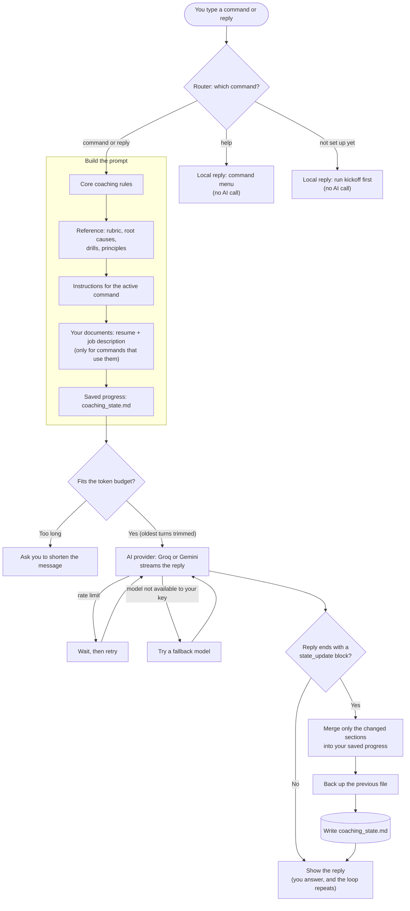
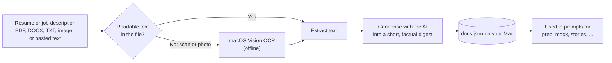
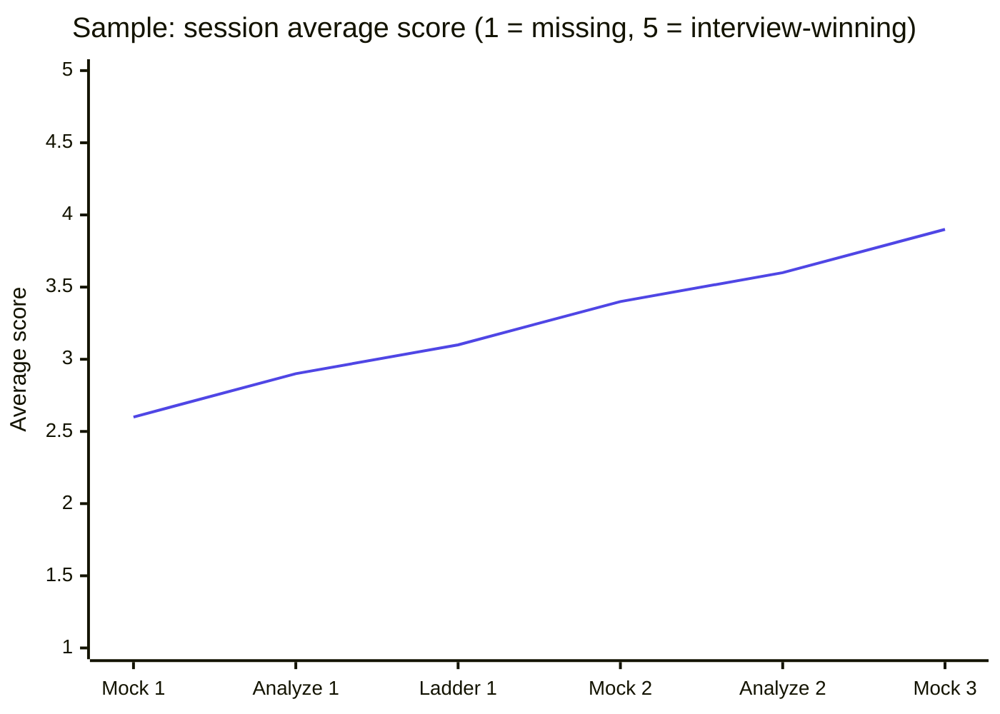
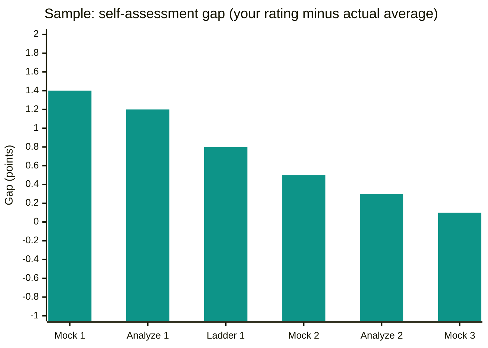

# Interview Coach

An AI interview coach that scores your answers on evidence, diagnoses why they lose points, and tracks your progress across your whole job search. It covers company research, prep briefs, story mining, drills, mock interviews, transcript analysis, thank-you notes, negotiation scripts, rejection debriefs and a final retrospective.

This repo has two versions of the same coach:

| Folder | What it is | Needs |
|---|---|---|
| [`app/`](./app) | macOS desktop app (Electron). Resume and job-description upload (PDF, DOCX, scans via OCR), persistent progress, free-tier friendly. | A free Groq or Gemini API key |
| [`vscode-version/`](./vscode-version) | The same coaching instructions as plain markdown for an AI agent in a folder (GitHub Copilot, Claude Code, etc.). | An agent that can read and write files |

Start with the app: see [`app/README.md`](./app/README.md) for setup, build and data/privacy notes.

## How it works

Every message you send goes through the same loop: route the keyword, build a prompt from the coach's rules plus *your* documents and saved progress, call the AI, then merge any progress updates back into your saved file.

### Resume and job descriptions

Documents are read on your Mac, condensed once so they fit free-tier limits, and stored locally. Scans and photos go through macOS text recognition.

## What your progress looks like

Every scored answer (from `analyze`, `practice` and `mock`) is saved with a rating on five dimensions, plus the score you gave yourself *before* seeing it. Two trends matter most.

> The charts below use **sample numbers** to show the idea. They are not real results, and they are drawn from your saved progress file rather than rendered by the app.

**Score trend** is the session average (1 to 5). It should climb as you drill your bottleneck.

**Self-assessment gap** is your own rating minus the actual average. Above zero means you overrate your answers; below zero means you underrate them. The goal is a gap that shrinks toward zero, because that is the self-awareness that carries into the real interview.

## Privacy

Your progress file, resume, job descriptions and API keys are never part of this repo. The app stores them on your machine and the `.gitignore` excludes them. The text you chat is sent to the AI provider you choose.
